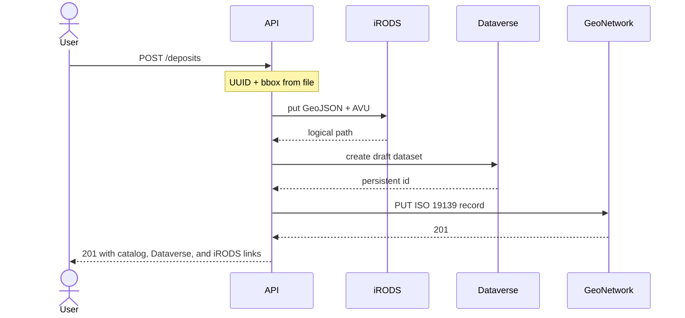

# demo-geo-deposit

[](https://github.com/Merwanel/demo-geo-deposit/actions/workflows/ci.yml)
[](https://codecov.io/gh/Merwanel/demo-geo-deposit)



A `POST /deposits` puts the GeoJSON in a local iRODS zone under `/tempZone/home/rods/deposits/{uuid}.geojson` and tags that object with the deposit UUID. It creates a draft on `demo.dataverse.org` that cites the iRODS path but does not upload the file, then publishes an ISO 19139 record in GeoNetwork that is publicly visible and links the catalog page, the Dataverse draft, and the iRODS path. Depositing the same file bytes again returns HTTP 409.

## Tech stack

- FastAPI and uv (Python 3.14)
- python-irodsclient for iRODS 4.3.5
- pygeometa for ISO 19139
- pyDataverse for draft datasets on `demo.dataverse.org`
- GeoNetwork 4.4.12 with Elasticsearch 8.19.13 and PostgreSQL 17.6
- Local iRODS 4.3.5 provider with a separate PostgreSQL ICAT database

## Prerequisites

- Docker Engine with Compose
- [uv](https://docs.astral.sh/uv/) (for local tests and development)
- A free account on [demo.dataverse.org](https://demo.dataverse.org/) and an API token ([Account Guide](https://guides.dataverse.org/en/latest/user/account.html)). Copy `.env.example` to `.env` and set `DATAVERSE_TOKEN`. Deposits fail without it.

## Quickstart

```bash
cp .env.example .env
# edit .env and set DATAVERSE_TOKEN
docker compose up --build
```

A one-shot `seed` service waits for the API, then deposits `samples/two-cities.geojson` (HTTP 201 on first boot, 409 if the sample is already in the catalog). Open the catalog at http://localhost:8080/geonetwork (`admin` / `admin`); the sample record is visible without logging in. The response also includes the Dataverse draft URL and the iRODS path.

To deposit another file yourself, either use the interactive docs at http://localhost:8000/docs (`POST /deposits` → Try it out), or:

```bash
curl -sS -F "file=@samples/two-cities.geojson" \
  -F "title=Paris and Lyon" \
  -F "author=Demo author" \
  -F "license=CC BY 4.0" \
  -F "abstract=A point in Paris and a point in Lyon." \
  http://localhost:8000/deposits
```

List the deposited objects in the local zone:

```bash
docker compose exec irods su - irods -c 'ils /tempZone/home/rods/deposits'
```

To stop and wipe the app:

```bash
docker compose down -v
```

Drafts on `demo.dataverse.org` are not removed by docker; the demo server deletes datasets every month.

## Testing


```bash
uv sync
uv run pytest
```

Integration tests use [testcontainers](https://testcontainers.com/).

## CI

On every push to `main`, GitHub Actions runs Ruff, the full pytest suite (including the catalog; Dataverse and iRODS stay mocked), uploads coverage to Codecov, validates Compose, builds and pushes `ghcr.io/merwanel/demo-geo-deposit` tagged `latest` and with a CalVer tag `YYYY.MM.DD-HH.MM.SS`, then runs Trivy.
