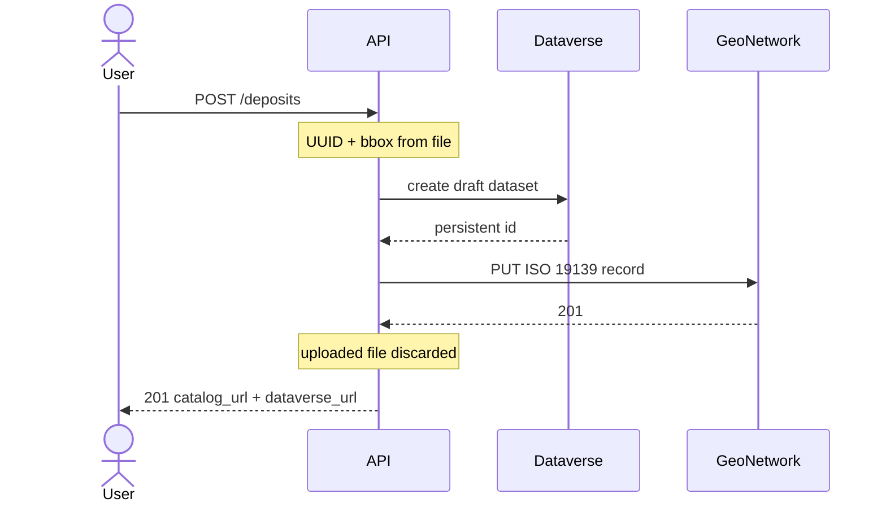

# demo-geo-deposit

[](https://github.com/Merwanel/demo-geo-deposit/actions/workflows/ci.yml)
[](https://codecov.io/gh/Merwanel/demo-geo-deposit)

demo-geo-deposit turns a GeoJSON file, a title, an author, a license, and an abstract into an ISO 19139 record in a local GeoNetwork catalog and a draft dataset on the public Dataverse demo server.




## Features

- One-command local stack: GeoNetwork, Elasticsearch, PostgreSQL, and the deposit API
- Startup seed deposits `samples/two-cities.geojson` once the API is healthy (requires a Dataverse token)
- Multipart deposit that builds ISO 19139 metadata with pygeometa and a Dataverse draft with pyDataverse
- Catalog records published so they are visible without logging in, with links to the catalog page and the Dataverse draft
- Deterministic UUID fingerprint of the uploaded file bytes; duplicates return HTTP 409

## How a deposit flows

1. The user sends `POST /deposits` as `multipart/form-data` with `file`, `title`, `author`, `license`, and `abstract`. A non-blank `DATAVERSE_TOKEN` is required.
2. The API fingerprints the raw file bytes into a UUID and walks the GeoJSON for a WGS 84 bounding box.
3. The API creates a draft dataset on `demo.dataverse.org` (title, author, license, abstract). The GeoJSON file is not uploaded to Dataverse. The API does not publish the draft.
4. The API builds an ISO 19139 record with two distribution links (catalog page and Dataverse draft), authenticates to GeoNetwork, and `PUT`s the XML with `publishToAll=true`.
5. On success the API returns HTTP 201 with `uuid`, `id`, `catalog_url`, and `dataverse_url`, and discards the uploaded bytes. Open `dataverse_url` while logged in as the token owner; other visitors are refused.
6. A second deposit of the same bytes still creates a Dataverse draft, then GeoNetwork rejects the UUID and the API returns HTTP 409 with the existing UUID (even when the title or other text fields differ). The extra draft is left on the demo server.
7. Other application failures (missing token, invalid GeoJSON, Dataverse or catalog errors) return HTTP 400 with `Deposit failed.` Missing form fields still return FastAPI's HTTP 422. If the catalog write fails after a draft was created, the draft is left on the demo server.

## Tech stack

- FastAPI and uv (Python 3.14)
- pygeometa for ISO 19139
- pyDataverse for draft datasets on `demo.dataverse.org`
- GeoNetwork 4.4.12 with Elasticsearch 8.19.13 and PostgreSQL 17.6

## Prerequisites

- Docker Engine with Compose
- [uv](https://docs.astral.sh/uv/) (for local tests and development)
- A free account on [demo.dataverse.org](https://demo.dataverse.org/) and an API token ([Account Guide](https://guides.dataverse.org/en/latest/user/account.html)). Copy `.env.example` to `.env` and set `DATAVERSE_TOKEN`. Deposits fail without it.

## Quickstart

```bash
cp .env.example .env
# edit .env and set DATAVERSE_TOKEN
docker compose up --build
```

A one-shot `seed` service waits for the API, then deposits `samples/two-cities.geojson` (HTTP 201 on first boot, 409 if the sample is already in the catalog). Open the catalog at http://localhost:8080/geonetwork (`admin` / `admin`); the sample record is visible without logging in. API docs are at http://localhost:8000/docs. The JSON also includes `dataverse_url` for the draft on the demo server.

To deposit another file yourself:

```bash
curl -sS -F "file=@samples/two-cities.geojson" \
  -F "title=Paris and Lyon" \
  -F "author=Demo author" \
  -F "license=CC BY 4.0" \
  -F "abstract=A point in Paris and a point in Lyon." \
  http://localhost:8000/deposits
```

## Ports

| Service    | Host port |
| ---------- | --------- |
| GeoNetwork | 8080      |
| API        | 8000      |

Elasticsearch and PostgreSQL stay on the Compose network only.

## Stopping and resetting

```bash
docker compose down
```

keeps the named volumes. To wipe the catalog and re-seed the sample:

```bash
docker compose down -v
docker compose up --build
```

Drafts on `demo.dataverse.org` are not removed by Compose; the demo server deletes datasets older than 30 days on a monthly schedule.

## Testing

```bash
uv sync
uv run pytest
```

Unit tests need no Docker and never call Dataverse. Integration tests start `geonetwork`, `elasticsearch`, and `database` from `docker-compose.yaml` once for the session via testcontainers, mock Dataverse, call the API in-process with FastAPI's `TestClient`, and do not build or start the `api` service. Port 8080 must be free. The deposit suite asserts HTTP 201, 400, and 409 only.

## CI

On every push to `main`, GitHub Actions runs Ruff, the full pytest suite (including the catalog; Dataverse stays mocked), uploads coverage to Codecov, validates Compose, builds and pushes `ghcr.io/merwanel/demo-geo-deposit` tagged `latest` and with a CalVer tag `YYYY.MM.DD-HH.MM.SS`, then runs Trivy (HIGH and CRITICAL findings are printed; they do not fail the job). CI has no Dataverse token.

## Project structure

```text
app/
  main.py           # FastAPI application
  config.py         # settings
  metadata.py       # GeoJSON rules and ISO 19139
  geonetwork.py     # catalog client
  dataverse.py      # Dataverse draft client
  routers/deposits.py
samples/two-cities.geojson
scripts/seed.sh
tests/
Dockerfile
docker-compose.yaml
```
